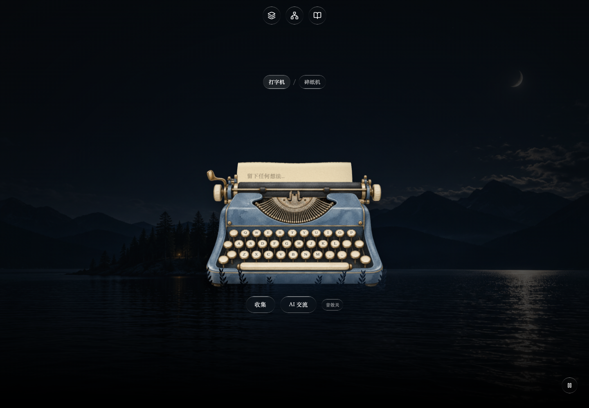
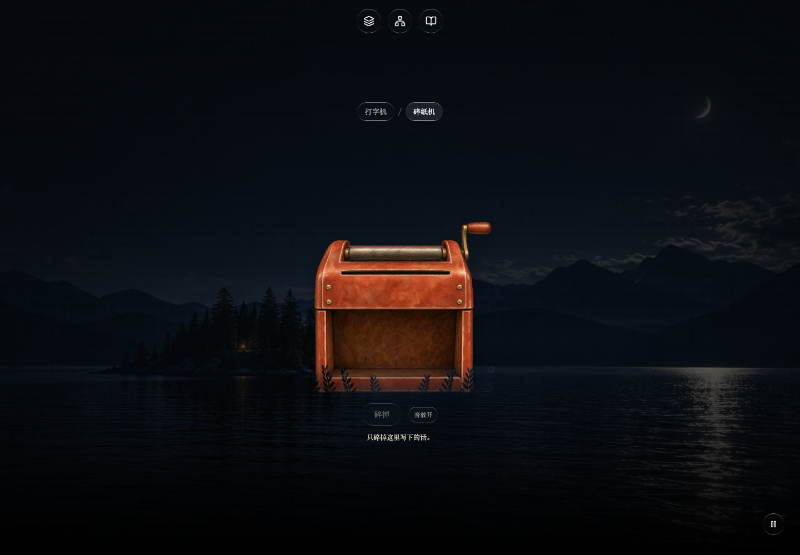
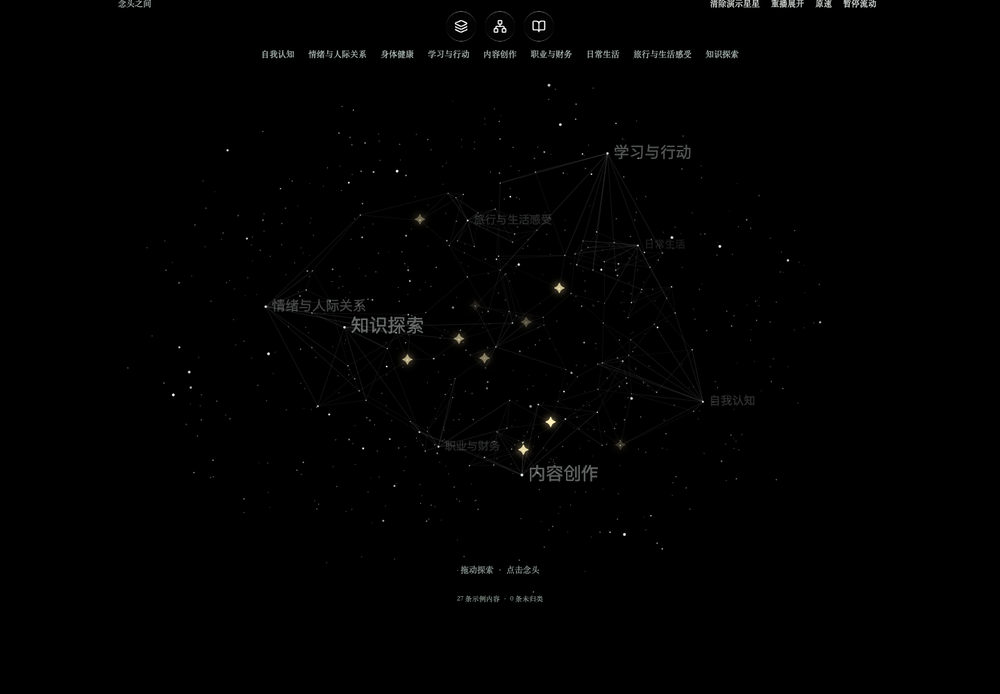
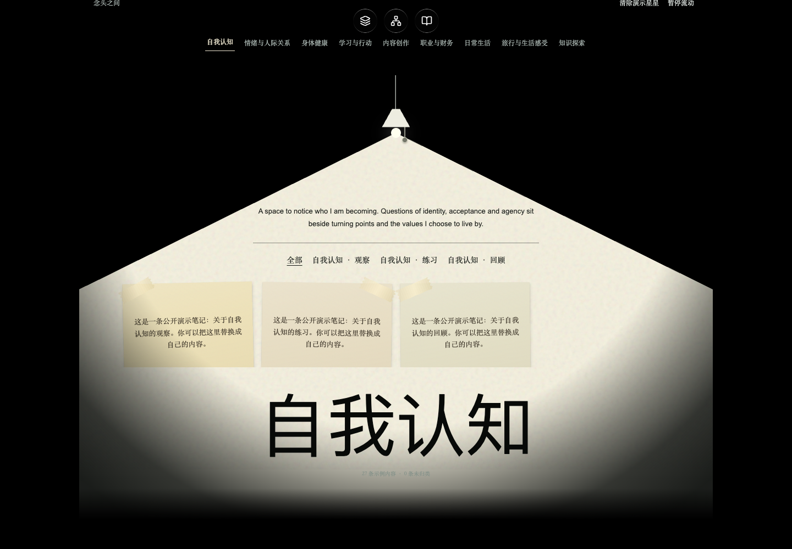
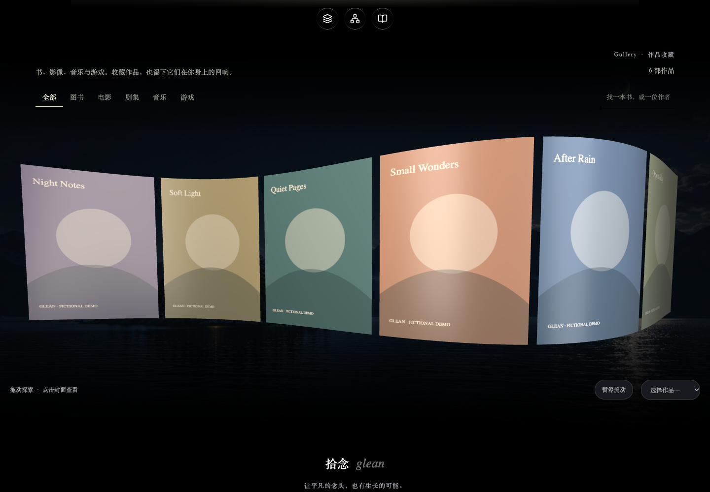

# pick-up-thoughts · 拾念

一个可以收集念头、探索关联、回看媒体的交互花园。React + TypeScript + Vite，拆成三个可阅读、可修改的模块。

**本仓库不包含作者的私人记录。所有笔记、主题下的内容、作品及封面均为演示数据。**

## 1. 复古打字机 · Vintage Typewriter





目录：[`src/modules/vintage-typewriter`](src/modules/vintage-typewriter)

- Three.js 2.5D 水彩机身、曲面纸张与文字纹理；并非完整实体机械模型。
- 原生输入框支持中文输入、图片粘贴、打字反馈和纸张上移。
- 可切换碎纸机，带纸条运动与音效。
- 收集后折成信封，飘向知识网化成星星；使用真实折纸录音和归位钟声。
- 本机 IndexedDB 保存；星星七天视觉淡出不会删除已保存内容。
- “AI 交流”保留未接通提示；没有模型调用、远程上传或同步后端。

## 2. 知识网 · Knowledge Connection Web





目录：[`src/modules/knowledge-connection-web`](src/modules/knowledge-connection-web)

- Canvas 2D 绘制的三维投影网络，一级标签在外层，二级节点位于内部。
- 直线展开、节点连接、拖动旋转、悬停关联线、点击进入灯光阅读。
- 聚类默认显示全部示例笔记；二级标签筛选；便签点击展开详情。
- 台灯、衰减光照、拉绳返回、底部聚类字形交互。
- 27 条合成笔记，9 个聚类；不连接私人档案。

## 3. 媒体画廊 · Media Gallery



目录：[`src/modules/media-gallery`](src/modules/media-gallery)

- Three.js 波浪封面、原始比例、柔和反光、拖动与惯性。
- 分类、搜索、暂停、点击详情。
- 6 张本仓库制作的 SVG 虚构作品封面，不携带个人阅读清单或商业书封。

## 运行

需要 Node.js 20.19+ 或 22.12+，以及 Python 3（仅用于数据检查）。

```sh
npm ci
npm run dev
# http://127.0.0.1:5194/
npm run build
npm run check:privacy
```

## 架构

```text
src/main.tsx                         页面组装、收集状态与区域导航
src/modules/vintage-typewriter/     输入、纸张、碎纸与信封飞行
src/modules/knowledge-connection-web/ 网络、灯下阅读与便签
src/modules/media-gallery/          波浪封面、筛选与作品详情
src/modules/shared/local-captures.ts 本地浏览器保存与星星衰减
src/shared/types.ts                 内容类型
public/local/                      仅合成示例 JSON 与 SVG 封面
public/machines/                   水彩机器图像
public/audio/                      CC0 折纸声与来源说明
```

模块通过 props 和公开示例 JSON 连接；保留现有组件，不添加服务层或数据库服务。`src/index.css` 提供共享风格，模块目录内的 CSS 控制局部视觉。资源使用根路径，部署时请放在域名根目录；GitHub 仓库本身不是在线部署。

## 替换内容

- `public/local/archive.json`：记录，`id`、`text`、`themes` 等。
- `public/local/thought-network.json`：聚类、节点及 `recordIds`；`related` 与 `parent` 使用节点数组下标。
- `public/local/gallery.json`：作品信息及封面路径。
- 请勿把个人档案导出、API 密钥或浏览器存储加入 Git。

## 视觉资产与边界

公开版本使用本地生成湖景和轻微 CSS 动画作为背景；原演示中的远程花园视频、第三方字体和参考网站音频未打包。中文使用系统宋体回退，因此背景和字体不会与私人版本完全一致。自有背景视频可以替换 `src/main.tsx` 的 `Film` 组件。

机器插画为 AI 生成素材；纸张、碎纸、网络和画廊动画由代码实现。折纸录音：Anthousai，CC0，[原始来源](https://freesound.org/people/Anthousai/sounds/398896/)，剪辑信息见 `public/audio/envelope-fold-source.txt`。不附加第三方资产的重新授权承诺；使用素材前请核对适用条款。

## 验证

已通过生产构建和合成数据隐私检查；桌面浏览器验证机器切换、进入灯下、便签详情、Gallery 详情，无页面运行错误。截图来自此公开示例版本，而非私人网站。未进行完整移动端和所有辅助技术验收。
